<div align="center">

# Intangible Heritage Dance Platform

**A full-stack Django platform for learning China's national intangible cultural heritage (ICH) traditional dances**

English | [简体中文](README.zh-CN.md)

[](https://www.python.org/)
[](https://www.djangoproject.com/)
[](https://neon.tech/)
[](https://echarts.apache.org/)
[](https://render.com/)

**Live demo: <https://dance-heritage.onrender.com>**
<sub>Free hosting tier: the first visit after 15 idle minutes takes about a minute to wake up.</sub>

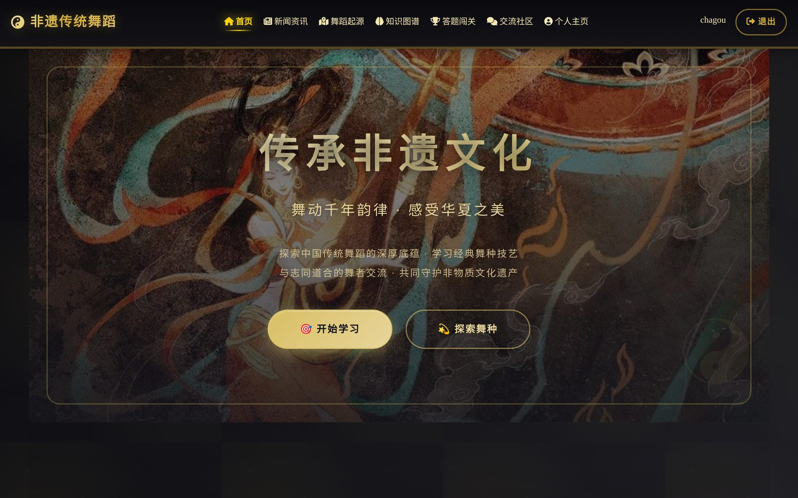

</div>

## Overview

China lists hundreds of traditional dances as national-level intangible cultural heritage, but the information about them is scattered across government lists, news articles and academic sources, and almost none of it is organised for someone who wants to *learn* a dance.

This platform brings that material together and turns it into a learning experience. It catalogues **356 national-level ICH dance items and 379 representative inheritors**, breaks each dance down into a structured knowledge graph, recommends what to learn next, tests understanding through timed quiz levels, and gives learners a community to share practice notes.

| Content | Count |
| --- | --- |
| National-level ICH dance items | 356 |
| Representative inheritors | 379 |
| Knowledge-graph nodes (modules · moves · knowledge points) | 565 · 1,149 · 1,276 |
| Learning resources | 1,209 |
| Quiz questions across 7 levels | 712 |

## Features

### Knowledge graph
Each dance is modelled as a four-level hierarchy: **dance → action module → specific move → knowledge point**, with difficulty, duration and learning resources attached to each move. Learners can browse it as cards or as an interactive ECharts force-directed graph.

<table>
<tr>
<td width="50%">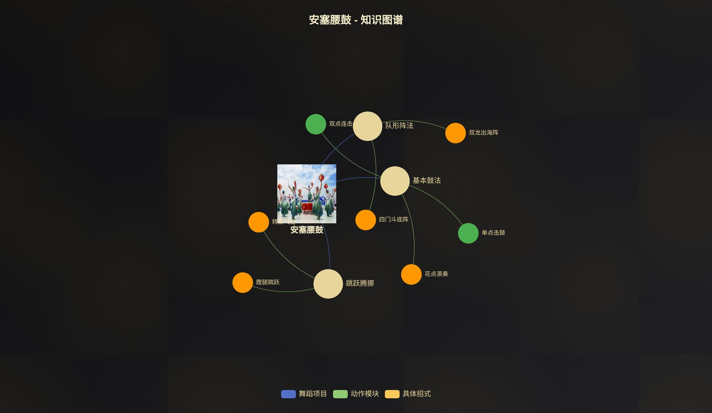</td>
<td width="50%">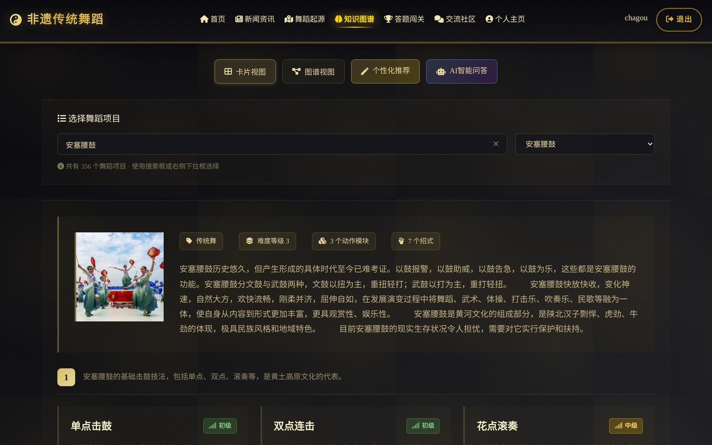</td>
</tr>
</table>

### Personalised recommendations and learning paths
A content-based recommender scores every dance the learner has not yet mastered and explains each recommendation in plain language (for example, "difficulty 3, matches your level 2" or "related to 7 knowledge points you have already learned"). For any dance it also generates a staged learning path from basic to advanced moves, and a progress dashboard tracks practice time and proficiency per move.

<table>
<tr>
<td width="50%">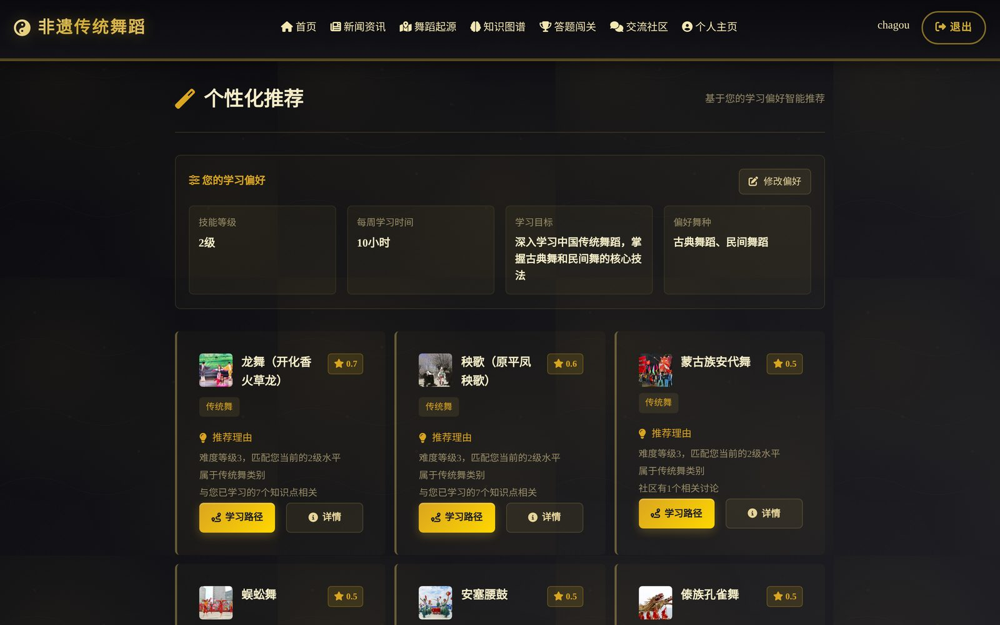</td>
<td width="50%">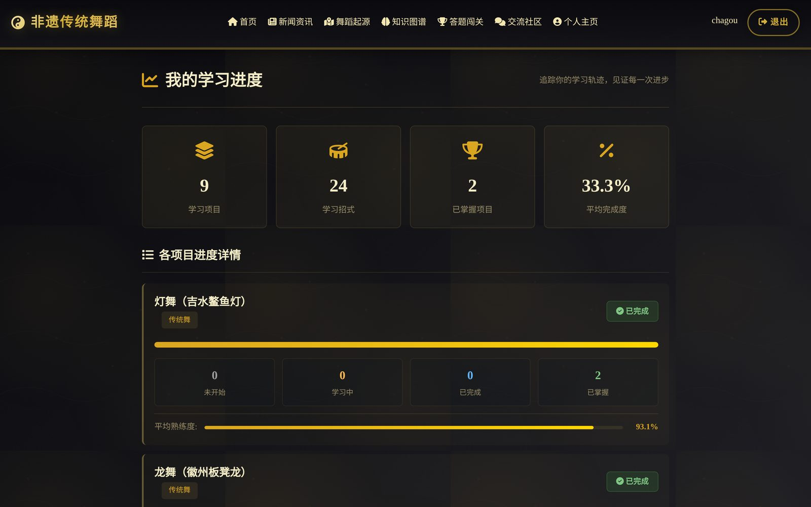</td>
</tr>
</table>

### Heritage catalogue
Browse all 356 dances on an interactive map of China or filter by region, listing year, category and keyword. Each dance has a detail page with its official item code, region, protecting unit, history and representative inheritors.

<table>
<tr>
<td width="50%">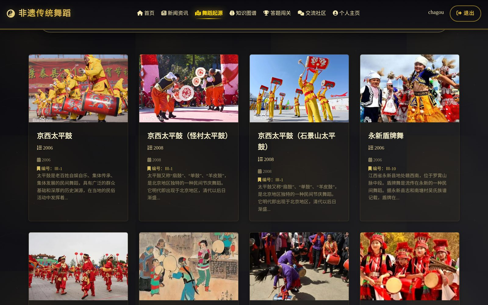</td>
<td width="50%">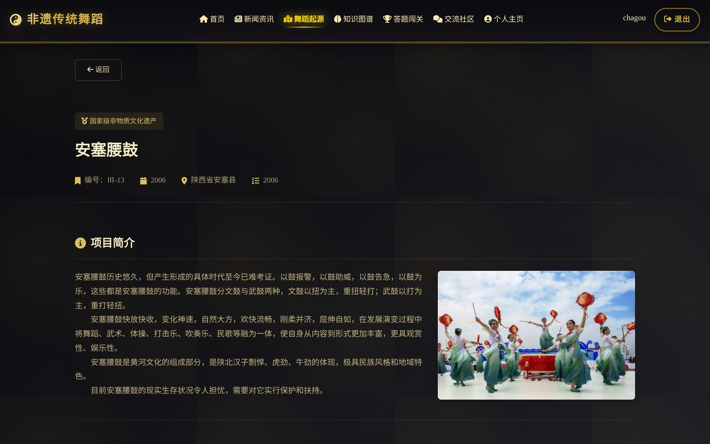</td>
</tr>
</table>

### Quiz levels
Seven progressively harder levels drawn from a 712-question bank, each with a time limit and pass mark. Results are recorded per attempt, and a wrong-answer book lets learners retry only the questions they missed.

<table>
<tr>
<td width="50%">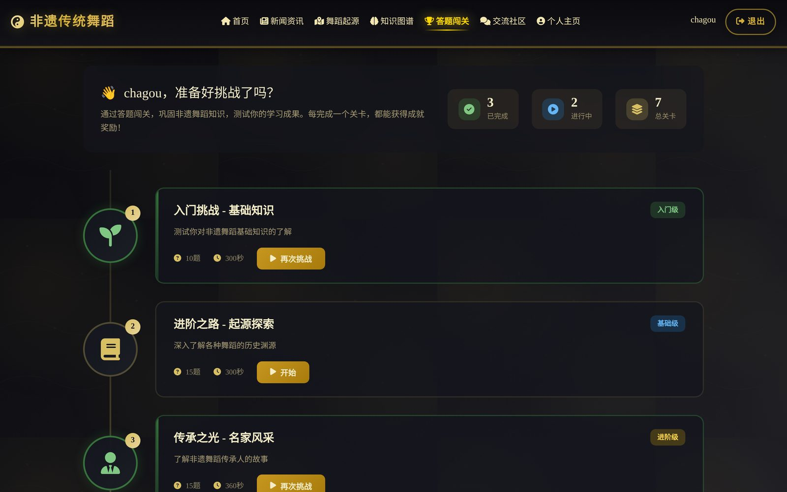</td>
<td width="50%">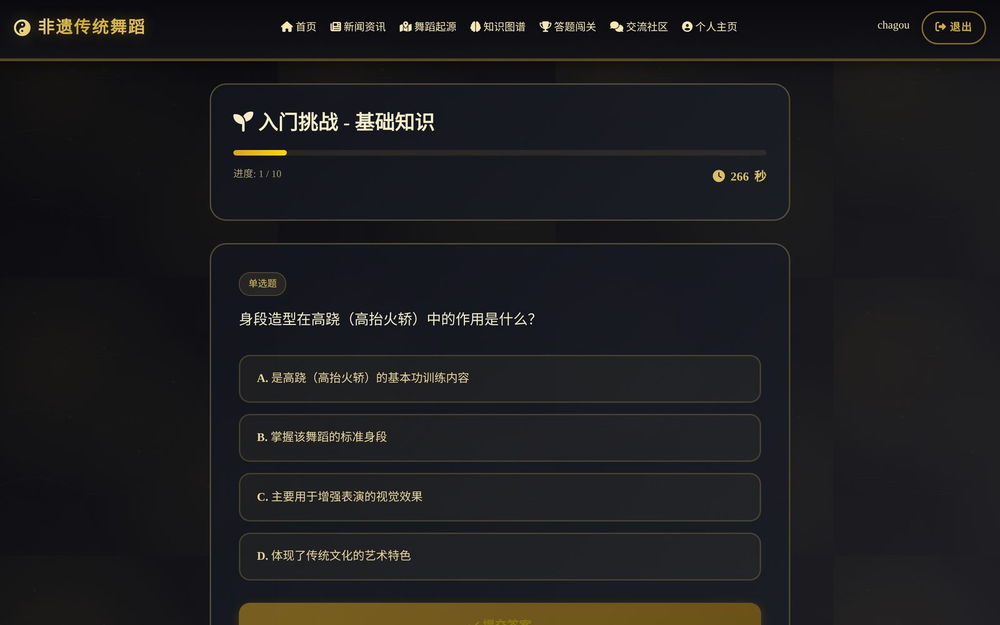</td>
</tr>
</table>

### Community and news
A community with topics, drafts, nested comment threads, likes, bookmarks and "latest / hot / featured" sorting; a news section for ICH events, policy documents and inheritor stories.

<table>
<tr>
<td width="50%">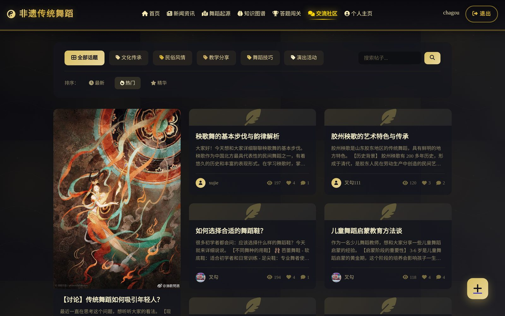</td>
<td width="50%">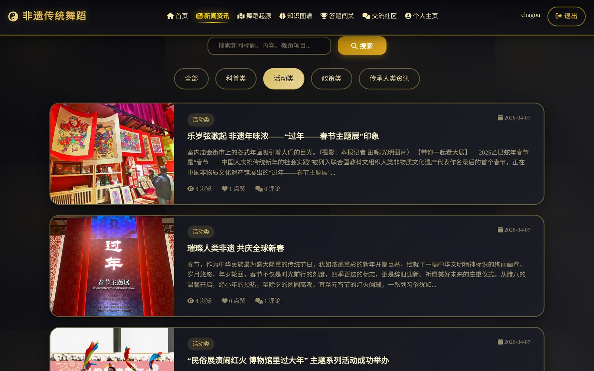</td>
</tr>
</table>

### AI Q&A
An assistant for questions about ICH dances, powered by Alibaba Cloud's Qwen (`qwen-plus`) through DashScope, with a domain-specific system prompt. It falls back to built-in answers when no API key is configured.

## Technical highlights

- **Explainable recommender.** The score is a weighted sum of five signals: difficulty match (25%), category preference (25%), overlap with knowledge already learned (20%), community popularity (15%) and continuity with recent study (15%). Every recommendation carries the reasons that produced it. See [`knowledge/recommendation_engine.py`](knowledge/recommendation_engine.py).
- **Data pipeline.** Management commands import the official dance and inheritor lists from Excel ([`import_excel_data`](origin/management/commands/import_excel_data.py)) and restore project images. A one-click script migrates the full local SQLite database (7,784 records) to production PostgreSQL and uploads the 365 media files to Cloudinary.
- **Fast migration to a remote database.** Django's `loaddata` saves one row at a time, which took close to an hour against a database on another continent. A custom bulk loader ([`fast_loaddata`](dance/management/commands/fast_loaddata.py)) batches inserts per model, preserves primary keys and resets sequences, cutting about 15,000 queries to 60.
- **Safe by default.** Before importing, a guard ([`check_target_database`](dance/management/commands/check_target_database.py)) refuses to touch any database that contains tables from another application. Secrets live only in environment variables, never in the repository.
- **Database-portable.** The same code runs on SQLite locally and PostgreSQL in production; a PostgreSQL-only bug (aggregating `MAX` over a boolean) was found and fixed during migration.
- **Production setup.** Gunicorn, WhiteNoise for compressed and cached static files, Cloudinary for media, and environment-driven security settings (secure cookies, CSRF trusted origins, HTTPS proxy header).

## Architecture

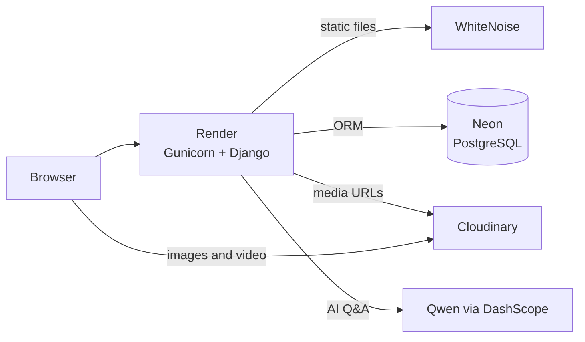

| App | Responsibility |
| --- | --- |
| `dance` | Home page, accounts, profiles, data-migration commands |
| `origin` | Dance items, inheritors, regions, Excel import |
| `knowledge` | Knowledge graph, recommender, learning paths, progress, AI Q&A |
| `quiz` | Question bank, levels, attempts, wrong-answer book |
| `community` | Topics, posts, drafts, comments, likes, bookmarks |
| `news` | News articles, likes, bookmarks, comments |

7 Django apps, 32 models and 22 automated tests.

## Tech stack

| Layer | Technology |
| --- | --- |
| Backend | Python 3.13, Django 5.1 |
| Database | SQLite (local), PostgreSQL on Neon (production) |
| Frontend | Django templates, vanilla JavaScript, ECharts, AMap, Font Awesome |
| AI | Qwen (`qwen-plus`) via Alibaba Cloud DashScope |
| Data | pandas and openpyxl for Excel import |
| Deployment | Render, Gunicorn, WhiteNoise, Cloudinary, dj-database-url |

## Getting started

Requires Python 3.10 or later.

```bash
git clone https://github.com/chagou313/DanceDjangoProject.git
cd DanceDjangoProject
bash start.sh          # creates .venv, installs dependencies, migrates and starts the server
```

On macOS you can also double-click `启动网站.command`. On Windows:

```bat
python -m venv .venv
.venv\Scripts\activate
pip install -r requirements.txt
python manage.py migrate
python manage.py runserver
```

Then open <http://127.0.0.1:8000>.

The database (`db.sqlite3`) and uploaded media (`media/`) are not in the repository because they contain user data. To start from an empty database with sample content:

```bash
python manage.py import_excel_data                       # 356 dance items and 379 inheritors from data/*.xlsx
python manage.py generate_all_real_knowledge_data        # knowledge graph
python manage.py generate_quiz_questions --limit 1000    # quiz bank
python manage.py init_topics                             # community topics
```

### Configuration

Copy `.env.example` to `.env` and fill in what you need:

| Variable | Purpose |
| --- | --- |
| `QWEN_API_KEY` | Enables the AI assistant ([Alibaba Cloud Model Studio](https://bailian.console.aliyun.com/)) |
| `DATABASE_URL` | PostgreSQL connection string; SQLite is used when unset |
| `CLOUDINARY_URL` | Stores media on Cloudinary; the local `media/` folder is used when unset |
| `DANCE_DEBUG`, `DANCE_SECRET_KEY`, `DANCE_ALLOWED_HOSTS`, `DANCE_CSRF_TRUSTED_ORIGINS` | Production settings |

## Deployment

The site runs on Render's free tier, configured in [`render.yaml`](render.yaml), with Neon PostgreSQL for data and Cloudinary for media. Every merge to `main` triggers an automatic rebuild, and migrations run on start-up.

First-time setup:

1. Create a Neon database and copy its connection string; copy your `CLOUDINARY_URL` from the Cloudinary console.
2. Put both in a local `.env.deploy` file (git-ignored) and run `上传数据到线上.command` to import the data and upload media.
3. In Render, choose **New → Blueprint**, select this repository and fill in `DATABASE_URL`, `CLOUDINARY_URL` and optionally `QWEN_API_KEY`.

## Project structure

```
DancedjangoProject/   settings, URLs, WSGI
dance/                home, accounts, profiles, migration commands
origin/               dance items, inheritors, regions, Excel import
knowledge/            knowledge graph, recommender, learning paths, AI Q&A
quiz/                 question bank, levels, attempts
community/            posts, topics, comments
news/                 news articles
templates/            page templates
static/               site images
data/                 source Excel data and import guide
docs/screenshots/     README screenshots
tests/                start-up and configuration tests
```

## Tests

```bash
python manage.py test
```

## Author

Built by [chagou313](https://github.com/chagou313).
