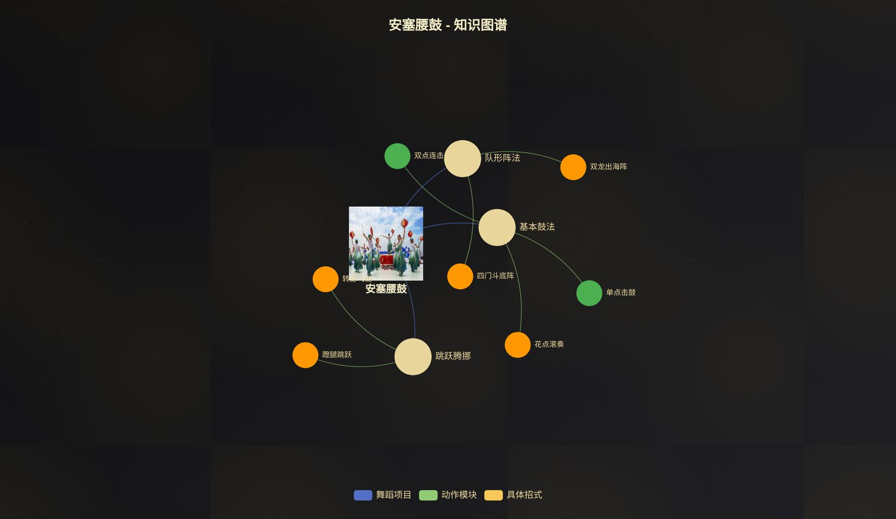
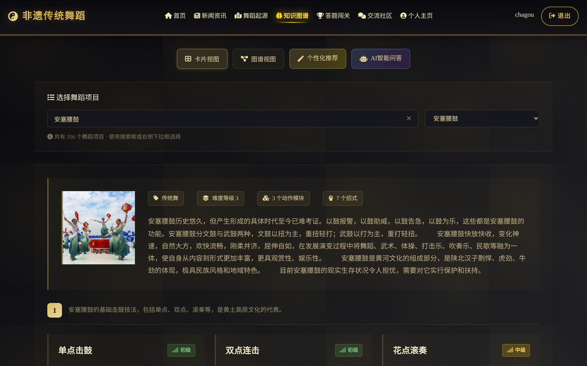
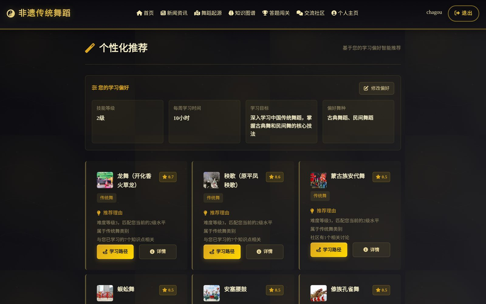
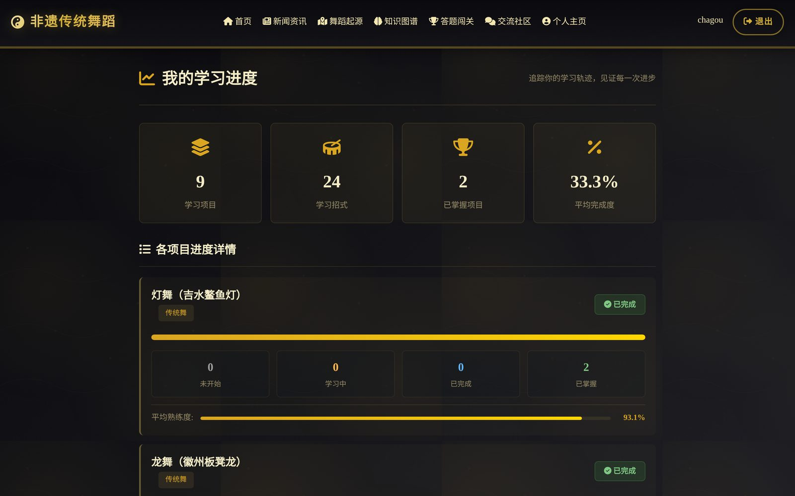
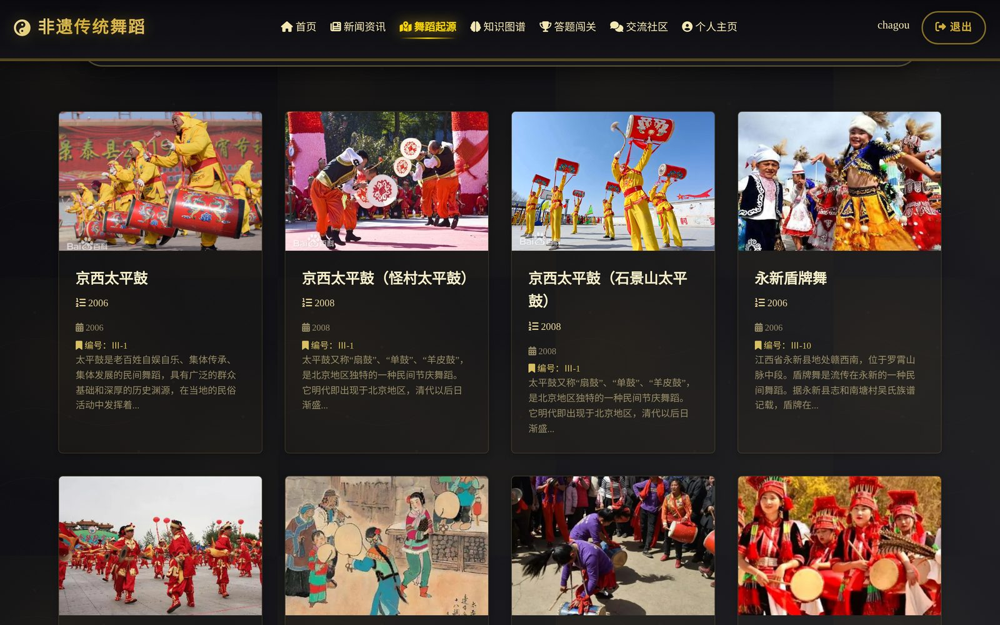
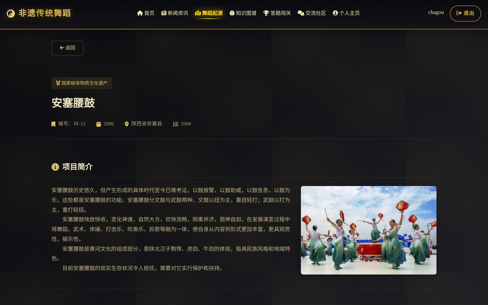
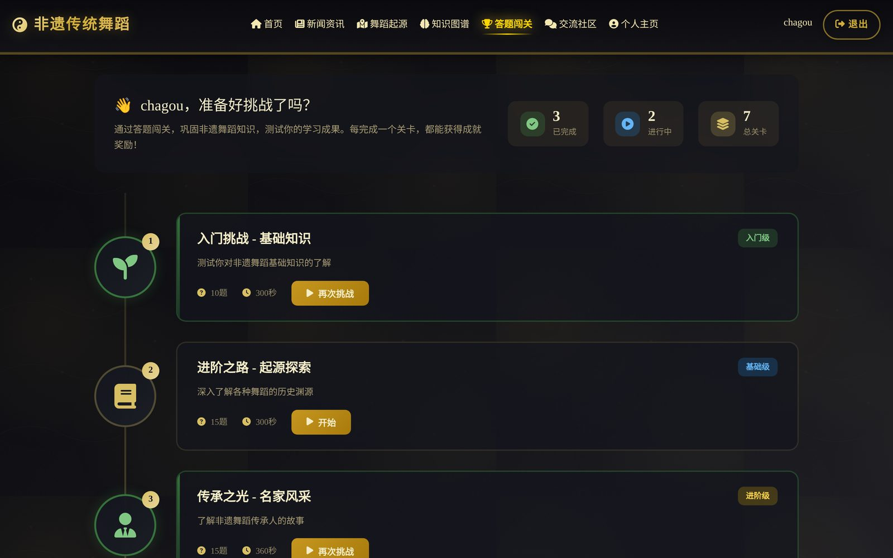
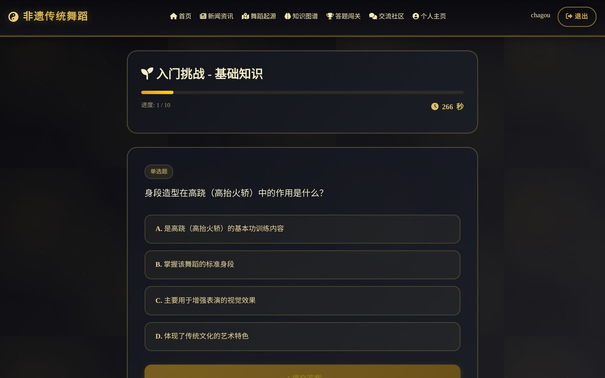
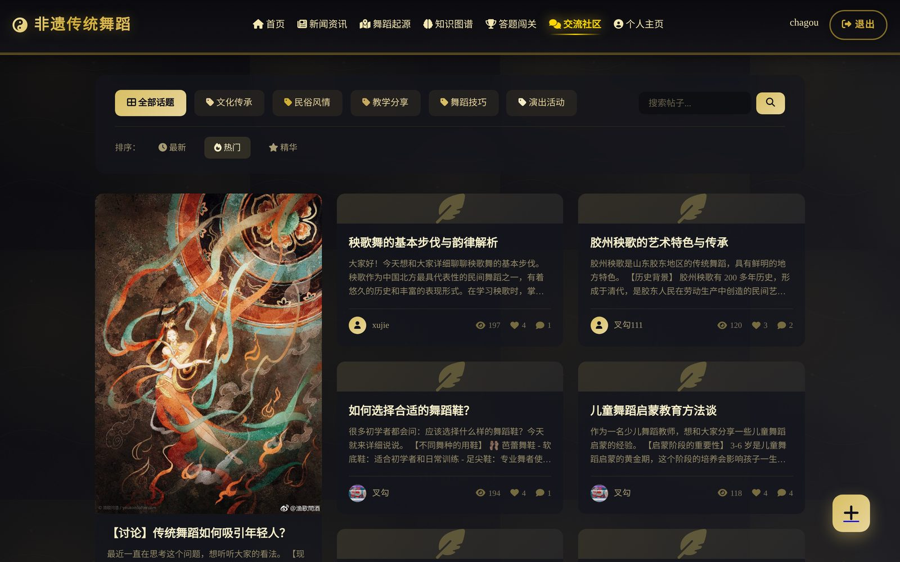
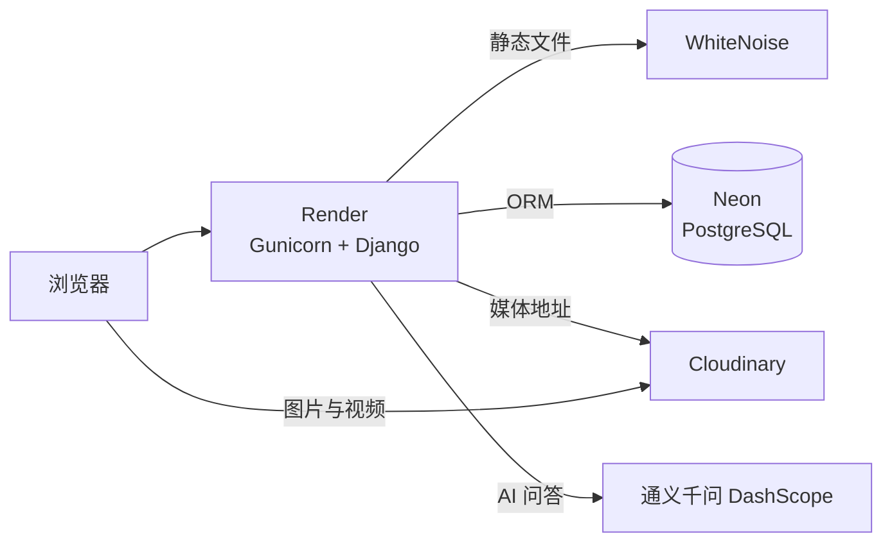

<div align="center">

# 非遗传统舞蹈平台

**基于 Django 的中国国家级非物质文化遗产传统舞蹈学习与交流平台**

[English](README.md) | 简体中文

[](https://www.python.org/)
[](https://www.djangoproject.com/)
[](https://neon.tech/)
[](https://echarts.apache.org/)
[](https://render.com/)

**在线访问：<https://dance-heritage.onrender.com>**
<sub>免费服务，15 分钟无人访问会休眠，再次打开需要等待约一分钟。</sub>


</div>

## 项目简介

我国有数百项传统舞蹈被列入国家级非物质文化遗产名录，但相关资料分散在政府名录、新闻报道和学术文献中，几乎没有面向“想学这支舞的人”整理过。

本平台把这些资料汇集起来，做成一个学习工具：收录 **356 项国家级非遗传统舞蹈和 379 位代表性传承人**，把每支舞拆解成结构化的知识图谱，根据学习情况推荐下一步学什么，用限时闯关检验掌握程度，并提供社区供学习者交流练习心得。

| 内容 | 数量 |
| --- | --- |
| 国家级非遗舞蹈项目 | 356 |
| 代表性传承人 | 379 |
| 知识图谱节点（动作模块 · 招式 · 知识点） | 565 · 1,149 · 1,276 |
| 学习资源 | 1,209 |
| 题库（7 个关卡） | 712 道 |

## 功能

### 知识图谱
每支舞按四层结构建模：**舞蹈项目 → 动作模块 → 具体招式 → 知识点**，每个招式附带难度、练习时长和学习资源。可以用卡片视图浏览，也可以用 ECharts 力导向图交互查看。

<table>
<tr>
<td width="50%"></td>
<td width="50%"></td>
</tr>
</table>

### 个性化推荐与学习路径
基于内容的推荐算法为每个尚未掌握的项目打分，并用通俗的话说明推荐理由，例如“难度等级 3，匹配您当前的 2 级水平”“与您已学习的 7 个知识点相关”。系统还能为任意项目生成由浅入深的分阶段学习路径；学习进度页按招式记录练习时长和熟练度。

<table>
<tr>
<td width="50%"></td>
<td width="50%"></td>
</tr>
</table>

### 非遗名录
在中国地图上按地区浏览全部 356 项舞蹈，或按地区、公布年份、类别、关键词筛选。每个项目有详情页，包含官方项目编号、申报地区、保护单位、历史介绍和代表性传承人。

<table>
<tr>
<td width="50%"></td>
<td width="50%"></td>
</tr>
</table>

### 答题闯关
7 个难度递进的关卡，题目来自 712 道题的题库，每关有限时和及格线。每次作答都会记录成绩，错题本可以只重做答错的题目。

<table>
<tr>
<td width="50%"></td>
<td width="50%"></td>
</tr>
</table>

### 交流社区与新闻资讯
社区支持话题分类、草稿、多级评论、点赞、收藏，以及“最新 / 热门 / 精华”排序；新闻资讯收录非遗活动、政策法规和传承人动态。

<table>
<tr>
<td width="50%"></td>
<td width="50%"></td>
</tr>
</table>

### AI 智能问答
接入阿里云通义千问（`qwen-plus`，通过 DashScope 调用），配合非遗舞蹈领域的系统提示词回答问题；未配置 API Key 时返回内置回复。

## 技术亮点

- **可解释的推荐算法**：推荐分由五项加权得出——难度匹配（25%）、类别偏好（25%）、与已学知识点的关联（20%）、社区热度（15%）、学习连续性（15%），每条推荐都附带生成它的理由。代码见 [`knowledge/recommendation_engine.py`](knowledge/recommendation_engine.py)。
- **数据管道**：管理命令从 Excel 导入官方舞蹈项目与传承人名录（[`import_excel_data`](origin/management/commands/import_excel_data.py)）并恢复项目图片；一键脚本把本地 SQLite 的全部数据（7,784 条记录）迁移到线上 PostgreSQL，并把 365 个媒体文件上传到 Cloudinary。
- **跨洲数据库的快速迁移**：Django 自带的 `loaddata` 逐条保存，导入到海外数据库要将近一小时。自写的批量导入命令（[`fast_loaddata`](dance/management/commands/fast_loaddata.py)）按模型分批插入、保留主键并重置序列，查询次数从约 15,000 次降到 60 次。
- **默认安全**：导入前先检查（[`check_target_database`](dance/management/commands/check_target_database.py)），目标数据库中有其他应用的数据表就拒绝操作；密钥只放在环境变量里，不进仓库。
- **数据库可移植**：同一套代码本地跑 SQLite、线上跑 PostgreSQL；迁移时发现并修复了一个只在 PostgreSQL 上出现的问题（对布尔字段求 `MAX`）。
- **生产环境配置**：Gunicorn、WhiteNoise（静态文件压缩与缓存）、Cloudinary 媒体存储，安全相关设置（安全 Cookie、CSRF 可信来源、HTTPS 代理头）均由环境变量控制。

## 系统架构



| 应用 | 职责 |
| --- | --- |
| `dance` | 首页、账号、个人主页、数据迁移命令 |
| `origin` | 舞蹈项目、传承人、地区、Excel 导入 |
| `knowledge` | 知识图谱、推荐算法、学习路径、学习进度、AI 问答 |
| `quiz` | 题库、关卡、作答记录、错题本 |
| `community` | 话题、帖子、草稿、评论、点赞、收藏 |
| `news` | 新闻资讯、点赞、收藏、评论 |

共 7 个 Django 应用、32 个数据模型、22 个自动化测试。

## 技术栈

| 层 | 技术 |
| --- | --- |
| 后端 | Python 3.13、Django 5.1 |
| 数据库 | SQLite（本地）、Neon PostgreSQL（线上） |
| 前端 | Django 模板、原生 JavaScript、ECharts、高德地图、Font Awesome |
| AI | 通义千问 `qwen-plus`（阿里云 DashScope） |
| 数据处理 | pandas、openpyxl |
| 部署 | Render、Gunicorn、WhiteNoise、Cloudinary、dj-database-url |

## 本地运行

需要 Python 3.10 及以上版本。

```bash
git clone https://github.com/chagou313/DanceDjangoProject.git
cd DanceDjangoProject
bash start.sh          # 自动创建虚拟环境、安装依赖、迁移数据库并启动
```

macOS 也可以直接双击 `启动网站.command`。Windows：

```bat
python -m venv .venv
.venv\Scripts\activate
pip install -r requirements.txt
python manage.py migrate
python manage.py runserver
```

然后访问 <http://127.0.0.1:8000>。

数据库（`db.sqlite3`）和上传文件（`media/`）含有用户数据，不在仓库中。从空数据库开始时，可以这样生成内容：

```bash
python manage.py import_excel_data                       # 从 data/*.xlsx 导入 356 个项目和 379 位传承人
python manage.py generate_all_real_knowledge_data        # 知识图谱
python manage.py generate_quiz_questions --limit 1000    # 题库
python manage.py init_topics                             # 社区话题
```

### 配置

复制 `.env.example` 为 `.env`，按需填写：

| 变量 | 作用 |
| --- | --- |
| `QWEN_API_KEY` | 启用 AI 问答（[阿里云百炼](https://bailian.console.aliyun.com/)） |
| `DATABASE_URL` | PostgreSQL 连接字符串；不填时使用 SQLite |
| `CLOUDINARY_URL` | 媒体文件存到 Cloudinary；不填时使用本地 `media/` |
| `DANCE_DEBUG`、`DANCE_SECRET_KEY`、`DANCE_ALLOWED_HOSTS`、`DANCE_CSRF_TRUSTED_ORIGINS` | 线上环境配置 |

## 线上部署

网站部署在 Render 免费套餐上，配置见 [`render.yaml`](render.yaml)；数据存放在 Neon PostgreSQL，媒体文件存放在 Cloudinary。代码合并到 `main` 后 Render 自动重新构建，启动时自动执行数据库迁移。

第一次上线：

1. 在 Neon 新建数据库并复制连接字符串，在 Cloudinary 控制台复制 `CLOUDINARY_URL`。
2. 把两者写进本地的 `.env.deploy`（已被 git 忽略），运行 `上传数据到线上.command` 导入数据、上传图片。
3. 在 Render 选择 **New → Blueprint**，选中本仓库，填入 `DATABASE_URL`、`CLOUDINARY_URL`，以及可选的 `QWEN_API_KEY`。

## 目录结构

```
DancedjangoProject/   项目设置、路由、WSGI
dance/                首页、账号、个人主页、数据迁移命令
origin/               舞蹈项目、传承人、地区、Excel 导入
knowledge/            知识图谱、推荐算法、学习路径、AI 问答
quiz/                 题库、关卡、作答记录
community/            帖子、话题、评论
news/                 新闻资讯
templates/            页面模板
static/               站点图片
data/                 Excel 原始数据与导入说明
docs/screenshots/     README 截图
tests/                启动与配置测试
```

## 测试

```bash
python manage.py test
```

## 作者

[chagou313](https://github.com/chagou313)
